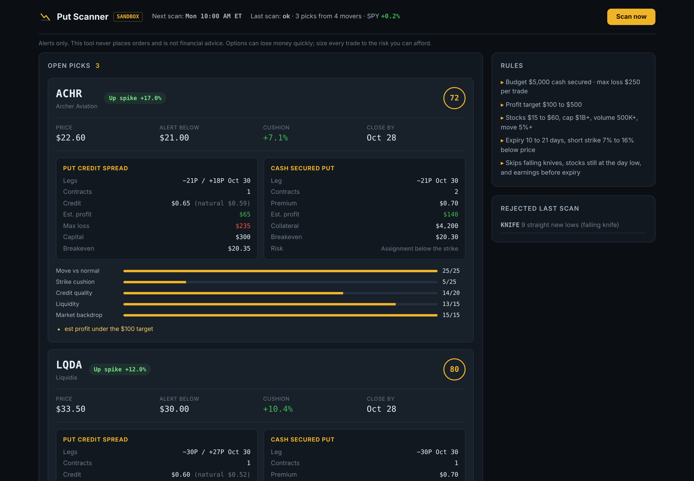
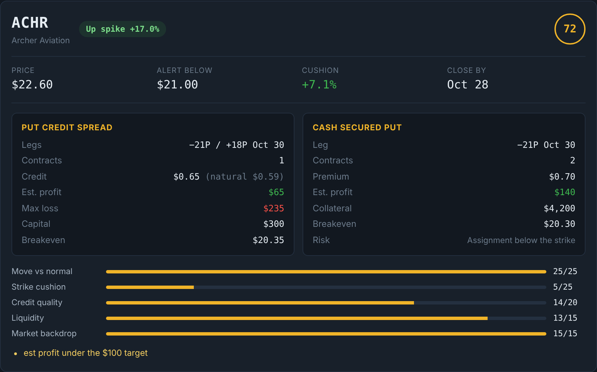
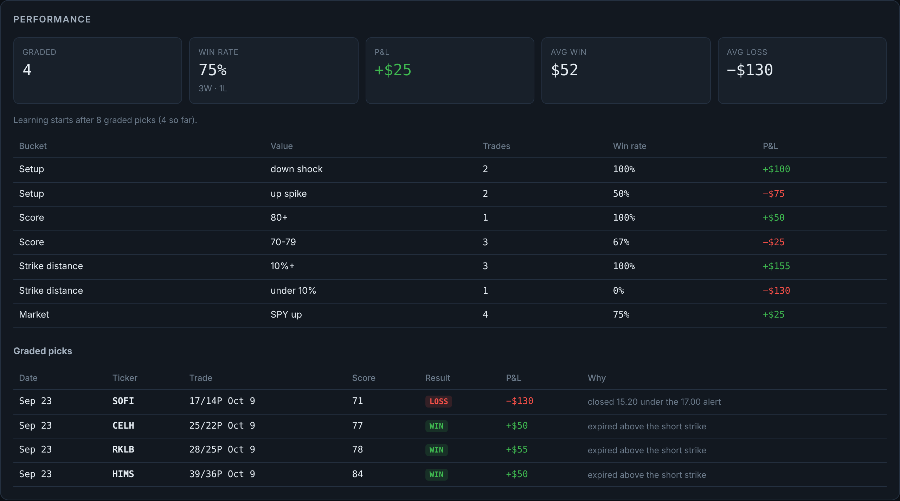
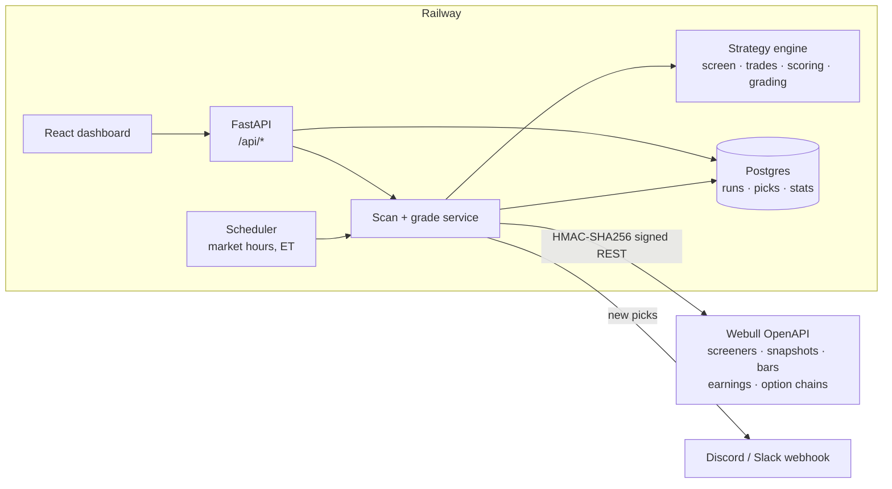

# Put Scanner

[](https://github.com/tonycmoney/put-scanner/actions/workflows/ci.yml)

A service that watches the day's biggest stock movers on Webull market data, finds put selling setups that pass a strict rule set, and sizes each one two ways: a defined risk **put credit spread** and a **cash secured put**. It runs on a market hours schedule, sends alerts, grades every pick after the close, and learns which kinds of setups to stop taking.

**Live:** https://web-production-6f005.up.railway.app

> **Alerts only.** The scanner reads market data. It has no code path that places, changes or cancels orders, and CI fails the build if one appears. Nothing here is financial advice.



## What it does

1. **Find movers.** Every scan pulls the day's top gainers and losers from Webull and snapshots SPY for the market backdrop.
2. **Screen.** Keeps stocks priced $15 to $60 with a $1B+ market cap, 500K+ volume and a 5%+ move. Drops anything with earnings before expiry and, for down moves, falling knives (3+ straight new lows) and stocks still within 1.5% of the day's low.
3. **Build trades.** Picks the expiry 10 to 21 days out, puts the short strike 7% to 16% below price, and prices spreads 2.5, 3 and 5 points wide from live option quotes. Spreads are sized so the max loss stays under 5% of the $5,000 budget; the cash secured put is sized to the same budget.
4. **Score.** 100 points across move vs the stock's normal daily range, strike cushion, credit quality, liquidity and market backdrop. Up to five picks per scan.
5. **Alert.** New picks go to a Discord or Slack webhook with legs, credit, alert level and the close by date.
6. **Grade.** After the close, open picks are marked against the closing price and option mids: take profit at 50% of credit, a loss if the stock closes under the alert level, otherwise expire at the strike.
7. **Adapt.** After 8 graded picks, any bucket (setup type, score band, strike distance, market direction) with 4+ trades and under a 35% win rate is filtered out of future scans.

| Pick card | Performance |
| --- | --- |
|  |  |

Screenshots are from a local run of the real scan and grading pipeline against the simulated market in the test suite (`scripts/simulate.py`), not live quotes.

## Architecture



| Layer | Choice | Why |
| --- | --- | --- |
| Market data | Webull OpenAPI, own client | The official SDK pulls in an MQTT stack that does not install cleanly; the REST client is about 220 lines with request signing verified against the SDK's own test vectors |
| Strategy | Pure Python dataclasses | Every rule is a pure function, so the engine is tested without a network or database |
| Service | FastAPI + SQLAlchemy 2 | Same stack as the API; SQLite locally, Postgres in production |
| Scheduling | In process asyncio loop | One container, one job lock, scans skip weekends and run in New York time |
| Frontend | React 19 + TypeScript + Vite | Served by the API container as static files |

### Webull request signing

Every request carries `x-app-key`, a timestamp, a nonce and an HMAC-SHA256 signature over the path, sorted query and signing headers, and the SHA-256 of the body. `app/webull/signing.py` is tested against known signatures for both a GET and a POST. When the account requires it, the client creates an access token and the dashboard tells you to approve it in the Webull app.

## Project layout

```
backend/
  app/
    webull/         signing.py, client.py (read only endpoints)
    market.py       Webull rows -> typed quotes, bars, option chains
    strategy/       rules, screen, trades, scoring, grading
    scanner.py      one scan from movers to ranked proposals
    service.py      persistence, token flow, grading
    scheduler.py    market hours job loop
    api.py, main.py HTTP API and SPA serving
  tests/            58 tests, 93% coverage, simulated market in fakes.py
frontend/           React dashboard + Vitest tests
scripts/simulate.py fills a local DB from the simulated market
```

## Running locally

Requirements: Python 3.12, Node 22.

```bash
# API
cd backend
python -m venv .venv && source .venv/bin/activate
pip install -r requirements-dev.txt
cp ../.env.example .env            # add your Webull app key and secret
python -m app.serve                # http://localhost:8000

# Dashboard with hot reload (proxies /api to :8000)
cd frontend
npm install
npm run dev                        # http://localhost:5173
```

Without Webull keys the service starts, serves the dashboard and stays idle. To see the dashboard with data and no keys:

```bash
cd backend
DATABASE_URL=sqlite:///./sim.db python ../scripts/simulate.py
DATABASE_URL=sqlite:///./sim.db SCHEDULER_ENABLED=false python -m app.serve
```

### Configuration

| Variable | Default | Notes |
| --- | --- | --- |
| `WEBULL_APP_KEY`, `WEBULL_APP_SECRET` | none | From Webull's API management page. Required to scan |
| `WEBULL_ENV` | `sandbox` | `sandbox` (paper) or `production` |
| `ALERT_WEBHOOK_URL` | none | Discord or Slack incoming webhook |
| `DATABASE_URL` | SQLite file | Postgres URL in production |
| `SCAN_TIMES` | `10:00,...,15:55` | New York time, weekdays |
| `GRADE_TIME` | `16:15` | After the close |
| `BUDGET`, `MAX_LOSS_PCT` | `5000`, `0.05` | Sizing for both trade types |

## Tests and CI

```bash
cd backend && pytest --cov=app        # 58 tests
cd frontend && npm test               # 7 tests
```

GitHub Actions runs on every push:

- **Backend:** ruff lint and format, tests on SQLite with an 85% coverage floor, the same tests on Postgres 16, and a check that no order placement code exists.
- **Frontend:** oxlint, TypeScript, Vitest, production build.
- **Docker:** builds the image, starts it with no secrets, and verifies it serves the dashboard, reports `configured: false` and returns 503 for a scan.

## Deploying on Railway

1. Create a project with a Postgres database and a service from this repo. `railway.json` builds the Dockerfile and health checks `/api/health`.
2. Set `DATABASE_URL=${{Postgres.DATABASE_URL}}`, `PORT=8000`, `WEBULL_ENV=sandbox`.
3. Add `WEBULL_APP_KEY` and `WEBULL_APP_SECRET` as service variables. Approve the API access request in the Webull app if one appears.

## License

MIT
